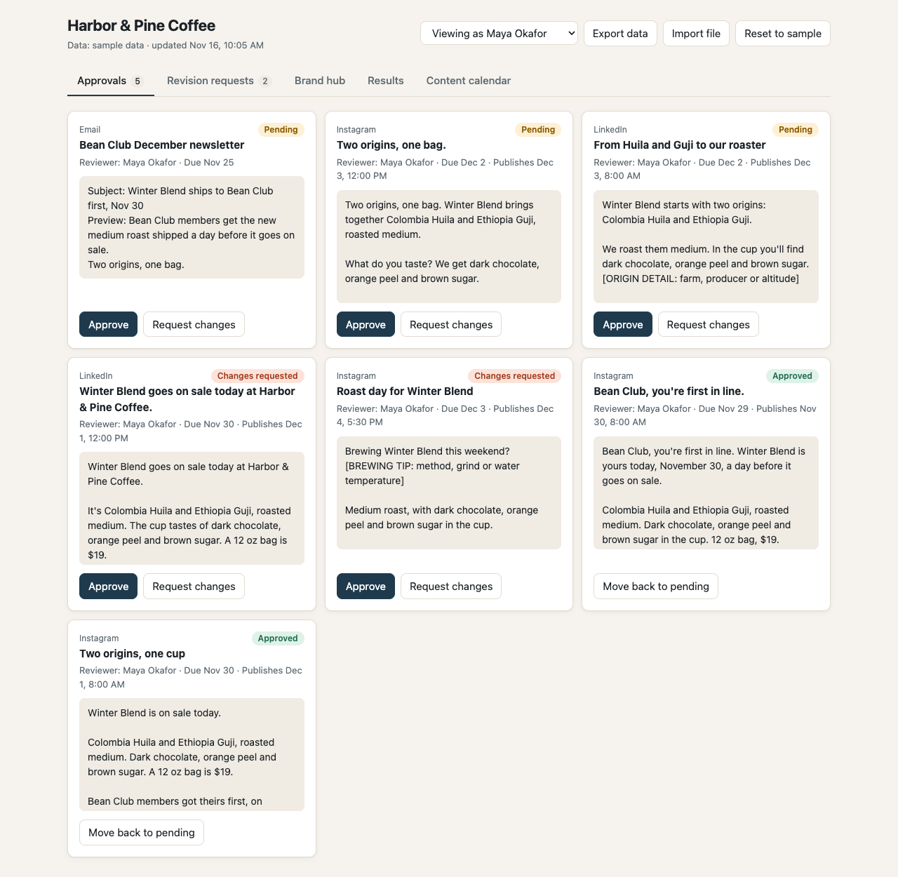
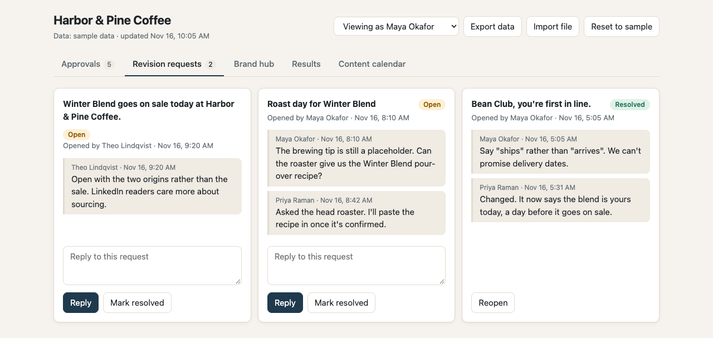
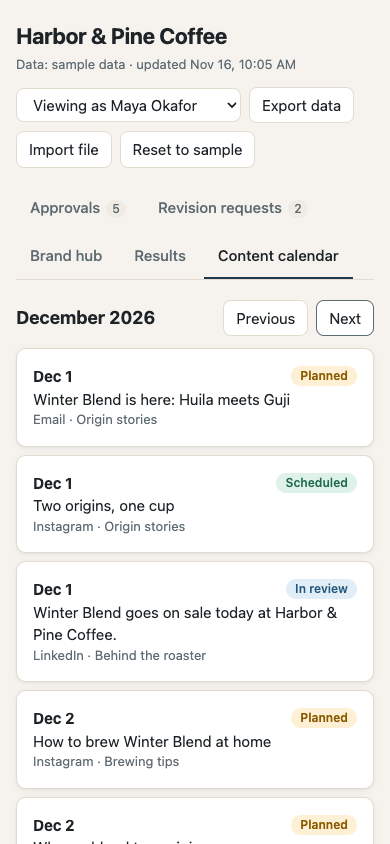

# Content Kit

[](https://github.com/blackwingArtisan/claude-content-kit/actions/workflows/ci.yml)

> **One brand file in, on-brand drafts out, checked before anyone sees them.** A Claude Code plugin that writes social posts, marketing emails and a content calendar from a single `brand.config.json`. Drafts go through a brand-voice editor, a fact-checker when they state facts, and a format checker, before they reach a review dashboard.

**License:** MIT · **Requires:** Claude Code, Node 22 or later

**For small content marketing teams who already use Claude Code.** The usual failure is not a missing draft. It is a post that drifts from the brand voice, quotes a number nobody can source, or arrives as a file the scheduling tool will not take. Content Kit keeps the brand rules in one file every command reads, has two review agents mark what they changed and what still needs confirming, and checks every output file with code.

The drafts then go into a five-tab review dashboard: import the posting schedule, calendar or email draft and each piece becomes an approval card and a calendar entry. Saved review work survives template changes; see [Design decision](#design-decision-the-template-never-owns-the-data).



The sample brand, Harbor & Pine Coffee, and everyone in the sample data are fictional.

## What it does

| Piece | What it does |
| --- | --- |
| `/content-kit:setup` | Asks eight short questions and writes `brand.config.json`: voice rules, banned claims, required disclosures, pillars, channels, call to action, approver. |
| `/content-kit:social-posts` | A week of posts per channel, spread across weekdays and pillars, as a posting-schedule CSV and paste-ready markdown. |
| `/content-kit:email-draft` | Three subject lines with preview text, an HTML-ready body, a plain-text version and the required disclosure. |
| `/content-kit:content-calendar` | A month of slots balanced across channels and pillars, as CSV and a week-by-week markdown view. |
| `brand-voice-editor` agent | Edits each draft against the config's do and don't rules and lists every change with the rule it applied. |
| `fact-checker` agent | Marks every number, date, price and claim as supported, unsupported or needs confirmation, with a source or a reason. |
| `scripts/check-output.js` | Checks CSV columns, quoting, dates, channels, pillars, UTM tags and channel limits, and email subject (50) and preview (90) lengths and disclosures. Every content command runs it and fixes what it reports. |
| `dashboard/` | Approvals, revision threads, brand hub, results and a calendar. Imports the plugin's CSV and email files, keeps data versioned, and makes no external requests. |

When a command needs a fact it was not given, it writes a marked placeholder such as `[BREWING TIP: method, grind or water temperature]` and lists it as an open question.

## Install

From GitHub, in Claude Code:

```bash
claude plugin marketplace add blackwingArtisan/claude-content-kit
claude plugin install content-kit@claude-content-kit
```

From a local clone:

```bash
git clone https://github.com/blackwingArtisan/claude-content-kit.git
claude plugin marketplace add ./claude-content-kit
claude plugin install content-kit@claude-content-kit
```

To try it for one session without installing: `claude --plugin-dir ./claude-content-kit`.

Commands are namespaced by the plugin (`/content-kit:social-posts`), and the agents appear as `content-kit:brand-voice-editor` and `content-kit:fact-checker`.

**Where files go.** Commands write files under `out/` and say which path they used. The plugin stores no credentials; when a Google Drive, Docs or Sheets connector is attached, the commands are written to save there instead. Set `workspace.mode` to `files` or `google` to force one.

## 60-second walkthrough

1. Open Claude Code in an empty folder and run `/content-kit:setup`, or copy [`examples/brand.config.json`](examples/brand.config.json) in.
2. Give the campaign and the facts the posts may use:

   ```
   /content-kit:social-posts "Winter Blend launch. Facts the posts may use: Winter Blend is Colombia Huila
   and Ethiopia Guji, roasted medium; tasting notes are dark chocolate, orange peel and brown sugar; a 12 oz
   bag is $19; it goes on sale December 1, and Bean Club members get it first, on November 30." --start 2026-11-30
   ```

3. The command drafts six posts, sends them to the two agents, writes `out/social/2026-11-30-winter-blend-launch/posting-schedule.csv`, runs the checker until it passes, then writes `posts.md` with the checked lengths. Its reply lists the open questions and who approves next.
4. `/content-kit:email-draft` and `/content-kit:content-calendar` work the same way.
5. `npm run dashboard`, open <http://127.0.0.1:4173>, and use **Import file** on the CSV or email draft. Posts that land on a planned calendar slot fill that slot; importing a file again updates the copy and keeps each card's review status.

The files in [`examples/out/`](examples/out/) are the unedited output of these three commands from one run on 2026-11-16 with Claude Code 2.1.325 and `claude-sonnet-5-5`. [`RUN.md`](examples/out/RUN.md) has the exact prompts and command line.

| Command | Output | Reviewed by |
| --- | --- | --- |
| `social-posts` | [6 posts](examples/out/social/2026-11-30-winter-blend-launch/posts.md) (4 Instagram, 2 LinkedIn), [schedule CSV](examples/out/social/2026-11-30-winter-blend-launch/posting-schedule.csv), 2 placeholders left for the team | brand-voice-editor, fact-checker, format checker |
| `email-draft` | [3 subject lines, HTML body, plain-text version](examples/out/email/2026-11-16-bean-club-december-newsletter.md) | brand-voice-editor, fact-checker, format checker |
| `content-calendar` | [28 slots](examples/out/calendar/2026-12-content-calendar.md) (16 Instagram, 8 LinkedIn, 4 email), [CSV](examples/out/calendar/2026-12-content-calendar.csv) | brand-voice-editor, format checker |

The dashboard's sample data is built from these files (`npm run build-sample`), with review activity added on top, so both halves show the same campaign.

## Design decision: the template never owns the data

The risky part of a shared dashboard is not drawing it. It is keeping each person's approvals, comments and calendar when the template changes. So the template (`index.html`) only renders data it is given, and every saved copy carries a `schemaVersion`. On load, `migrate.js` (shared by the browser and Node) brings it up to date:

```
saved data ──► readVersion ──► newer than this template? ──► refuse, change nothing
                    │
                    ▼
       every record has a unique id? ──── no ──► refuse, change nothing
                    │
                    ▼
     copy, then v1 → v2 → … one step per version
                    │
                    ▼
     same ids, same counts, every collection? ── no ──► refuse, save nothing
                    │
                    ▼
               render, then save
```

The core of it:

```js
function migrate(data) {
  const from = readVersion(data);                 // missing or invalid version: refused
  if (from > CURRENT_VERSION) throw new UnsupportedVersionError(/* ... */);
  recordIds(data, from);                          // every record needs a unique id
  if (from === CURRENT_VERSION) return data;      // current data is returned untouched

  let upgraded = structuredClone(data);           // the input is never mutated
  for (let version = from; version < CURRENT_VERSION; version += 1) {
    upgraded = STEPS[version](upgraded);
  }
  verifyNoRecordLoss(data, from, upgraded, CURRENT_VERSION);
  return upgraded;
}
```

The v1 to v2 step renames `approvals[].owner` to `reviewer` and turns flat revision notes into threads, with the original note as the first message. Fields the template does not know about pass through unchanged. The record-loss guard compares ids, not just counts, so an upgrade that drops one record and duplicates another still fails. Before shipping a template change, run the same check against a real saved file:

```bash
npm run check-upgrade -- tests/fixtures/dashboard-data.v1.json
```

```
before: {"schemaVersion":1,"approvals":5,"revisionRequests":3,"calendar":8,"results":5}
after:  {"schemaVersion":2,"approvals":5,"revisionRequests":3,"calendar":8,"results":5}
OK: upgrades with no records lost.
```

In the browser, a file from a newer template is refused with "Dashboard data is schema v3, but this template supports up to v2. It was probably saved by a newer template. Refusing to modify it. Nothing was changed." and the saved copy is left as it was.



## How it was tested

- **62 unit tests** (`npm test`, Node's built-in test runner, nothing to install), run in CI on Node 22 and 24: migrations and the record-loss guard; the output checker, its strict CSV parser and the email checks; the dashboard import and the sample-data build; the dashboard server (localhost only, path traversal, symlinks, unreadable files); and the plugin's manifests, commands, agents and skills. CI also checks the shipped examples and that the sample data matches them.
- **23 browser checks** (`npm run test:browser`, needs Playwright): every tab; Approve, Request changes, reply, resolve and reopen, with cards and calendar entries moving together; reload; Export; CSV and email import, including bad quoting; v1 upgrade on import and on load; refusal of future-version and broken data, with Export still downloading the saved copy byte for byte; the in-page Reset confirmation; hostile HTML, `javascript:` links and CSS in imported data; keyboard tabs and focus; and a 390px layout. 23 of 23 passed in headless Chromium.
- **Real plugin runs** of all three content commands, headless, in empty folders with no Google connector. Every output file passed the checker inside the run. Details in [`RUN.md`](examples/out/RUN.md).
- **Install** from GitHub and from a local clone, each into a throwaway `CLAUDE_CONFIG_DIR`, and **`claude plugin validate . --strict`**.

The checker exists because a model estimating lengths by eye is not reliable; code counts them instead.



## Limits

- The Google Workspace path is written into the commands but has not been run against a live connector.
- `/content-kit:setup` is an interview, so it was not part of the headless runs; [`examples/brand.config.json`](examples/brand.config.json) shows what it writes.
- Tested in Claude Code, not the Claude desktop app.
- Output varies between runs; the examples are one run of each command.

## Repository layout

```
.claude-plugin/     plugin.json, icon and a one-plugin marketplace.json
commands/           setup, social-posts, email-draft, content-calendar
agents/             brand-voice-editor, fact-checker
skills/             brand-config, brand-voice, workspace-output
scripts/            check-output.js (the format checker), build-sample-data.js
examples/           brand.config.json, and real output plus RUN.md in out/
dashboard/          index.html, migrate.js, formats.js, import.js, serve.js, data/
tests/              node:test suites, a v1 fixture, and browser checks in browser/
```

## License

MIT, see [LICENSE](LICENSE).
